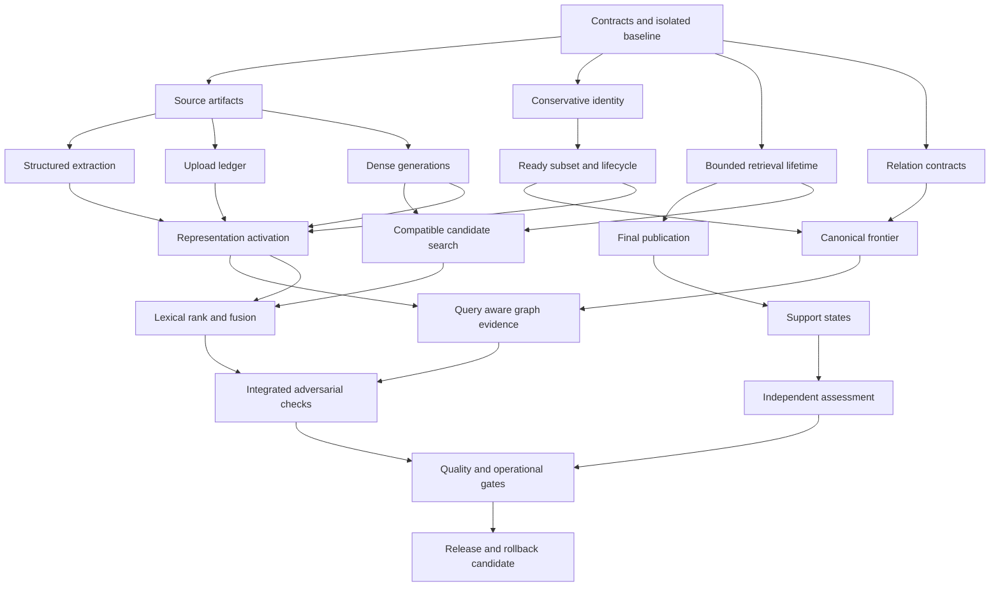

# RAG remediation parallel implementation plan

> **For agentic workers:** REQUIRED SUB-SKILL: Use superpowers:subagent-driven-development or superpowers:executing-plans to implement this plan task-by-task. The user explicitly requested parallel implementation. Use isolated worktrees, the ownership matrix and at most three concurrent worker slots; reviewers consume those slots too. Steps use checkbox syntax for tracking.

**Goal:** Address all 19 adversarial findings and the associated remaining retrieval concerns on current development, with evidence that distinguishes repaired code, migrated data, measured quality and deployed behavior.

**Architecture:** Four independent lanes deliver source/index integrity, retrieval/ranking, graph correctness and answer/memory integrity. A coordinator freezes contracts first, integrates small reviewed commits serially, and runs common migration, authorization, support-quality and rollout gates. Deterministic integrity fixes ship before optional ranking treatments.

**Tech Stack:** Existing Python/Django/PostgreSQL/pgvector/Memgraph/Celery stack, current model services, pytest, existing evidence-preservation and KG evaluation tooling.

**Spec:** [RAG remediation design](../specs/2026-10-10-rag-remediation-design.md).

**Baseline:** `origin/development` and reviewed HEAD `6e756e252999ee6ccf604f88ea5326f49ddaa6d4`, checked 2026-10-10. This plan is a planning deliverable; implementation checkboxes remain open. Refresh the baseline before execution and review intervening changes.

**Execution update:** The follow-up user request authorizes implementation and a review PR. Apply the [execution decisions](../../runbooks/rag-remediation-execution-decisions.md), which settle preflight contract gaps; task completion still requires recorded evidence.

## Execution status — 2026-10-15

The original program contains **21 feature tasks and four coordination/acceptance tasks**. All 21 feature tasks have mapped implementation and independent source-review evidence in the [release manifest](../../audits/rag-remediation-implementation/release-manifest.json). That candidate is an ancestor of current development and was integrated through [PR244](https://github.com/AquiLLM/AquiLLM/pull/244). This establishes implementation coverage; it does not close every task's live data, quality or activation requirements.

| Original tasks | Count | Implementation and current acceptance |
| --- | --- | --- |
| I1–I6: source, ingestion, indexing and retained citations | 6 | Implemented and merged, with populated migration/rollback tests. A bounded development text-embedding rebuild was performed during recovery; broader affected-data rebuild/coverage and semantic graph version cutover are not established by that work. |
| R1–R5: retrieval, ranking, references and evidence delivery | 5 | Implemented and merged. Basic development chat was restored through PR245. Optional treatment-specific quality/activation gates remain open. |
| G1–G6: graph identity, relations, evidence, traversal, readiness and gates | 6 | Implemented and merged with deterministic regression evidence. Live graph retrieval still fails its acceptance test; development serves with graph disabled. Runtime repairs continue in PR246. |
| A1–A4: answer publication, support and memory | 4 | Implemented and merged. Independent human assessment/calibration and optional semantic-support activation remain pending. |
| P0: contracts and isolated environment | 1 | Completed for the original implementation. |
| P1: integrated adversarial regression checks | 1 | Original candidate checks and their warnings/skips were recorded and reviewed. New recovery changes require their own verification. |
| P2: measured quality and operational acceptance | 1 | Incomplete. Evaluation/gating tools exist; current comparisons and the specified independent holdout/human review do not yet establish the required improvements. |
| P3: release and rollback | 1 | Original release and recovery were merged/deployed through PR244/245, with retained rollback evidence. The remaining graph release, its final acceptance and rollout are pending. |

The [October13 recovery plan](2026-10-13-development-retrieval-recovery.md) is follow-up work against runtime blockers found after the original implementation, not another count of completed original tasks. As of this update, native metadata integration and complete bounded graph-read batching are the two identified implementation blockers before live graph verification. The latest isolated graph candidate still reports a deadline and zero finalized graph candidates; a successful private fixture does not close that failure.

The remaining 73 development comparison cells are a diagnostic comparison, **not a substitute for P2's larger independent quality and human-review requirements below**. Original F05 graph rebuild/identity evidence, F19 meaningful holdout and treatment-specific activation requirements remain explicit. No overall completion percentage is assigned from code volume or test count.

The release/closure JSON files are historical candidate evidence and retain their original pre-deployment status fields. Use this dated status and the merged [PR245](https://github.com/AquiLLM/AquiLLM/pull/245) / active [PR246](https://github.com/AquiLLM/AquiLLM/pull/246) for subsequent runtime state. The original task checklists below remain the acceptance specification; this status does not silently mark unmet requirements complete.

## Read this program with the four lane plans

| Lane | Plan | Responsibility |
|---|---|---|
| I | [Source and index](2026-10-10-rag-source-index-remediation.md) | Immutable artifacts, structural extraction, resumable uploads, compatible dense generations and retained citations |
| R | [Retrieval and ranking](2026-10-10-rag-retrieval-remediation.md) | Reranker containment, candidate scope, lexical ranking/fusion, query preparation and evidence delivery |
| G | [Graph correctness](2026-10-10-rag-graph-remediation.md) | Identity, relation semantics, evidence sampling, canonical traversal, readiness and evaluation gates |
| A | [Answer and memory](2026-10-10-rag-answer-memory-remediation.md) | Final publication invariant, honest answer support, independent assessment and memory intent |

Each task is one independently reviewable deliverable. Larger tasks contain smaller test/implementation steps; completion requires the task's acceptance evidence, not merely a commit. Lane letters denote ownership, not permanent agents: dispatch a fresh implementer per task and a different reviewer afterward.

## Global constraints

- Preserve unrelated working-tree changes and historical plans. Only this program's new documentation is part of the current request. Implementation begins in managed worktrees from a refreshed pinned development commit.
- All shell commands start with `rtk`. Do not load shared `.env`, credentials, private corpus or runtime dumps into public files or test logs.
- Existing authorization and provenance validation remain mandatory at scope, candidate, materialization and publication boundaries. Zero revoked/private-source output, invalid final citations or incompatible dense comparisons is acceptable.
- Retain current chunk citations and source artifacts across representation changes. An embedding-only migration changes no citation identity. Rollback cannot reactivate unknown or incompatible vectors.
- Existing ceilings remain: 3 acquisition actions; 45 unique sources; 250,000 materialized and 1,000,000 tokenized codepoints; 90 acquisition + 45 final pairs; 6 in-flight pairs; 2 planner calls at 2 seconds/512 output tokens; 15-second retrieval deadline including 3-second final scoring allowance. Stricter operator limits win.
- Preserve current models, GPU allocation, 1024 pair context and graph budgets for controlled comparisons. Optional improvements activate one treatment at a time under their gates.
- Freeze questions and held-out labels independently of tuning. Never use private reference answers to author vocabulary or rewrite rules. Public tests use synthetic examples or explicitly publishable fixtures.
- The coordinator alone allocates migrations, edits shared model registries and deployment configuration, seeds integration environments, and controls model/DB benchmarking. Implementers do not deploy, rebuild shared collections, run destructive cleanup or recruit their own subagents.
- This plan authorizes no production changes. A later execution request can deliver code and a concrete rollout candidate; deployment uses the authorization in force at that time.

## Complete coverage and closure matrix

| Finding | Lead tasks | Required closure evidence |
|---|---|---|
| F01 Structured facts lost/corrupted | I1, I2, I5, I6 | Blank/formula/table/order fidelity; versioned structural chunks; affected data rebuilt or explicitly pending |
| F02 Mixed embedding spaces and hash reuse | I4, R2, I5, I6 | Wrong/unknown space excluded in real SQL; query response identity; safe reuse; verified coverage and rollback |
| F03 Invalid answers survive citation repair | A1 | Uncited/partly cited repair never reaches stream or persistence; authorized limited fallback |
| F04 Reranker outage amplification | R1 | 24-candidate outage causes one request with at most six pairs; later batches stop; process/turn work bounded; no late publication |
| F05 Homonym identity collapse | G1, G6 | Unanchored same-name entities remain distinct; stable positive identity and conflict cases; rebuilt version |
| F06 Prefix truncation loses answers | R5, A1, A2 | Exact suffix evidence reaches scorer and sealed generator request under an activated validated mode |
| F07 Arbitrary exact ordering/short identifiers | R3 | ATP-only flood cannot evict ATP+BRCA1 answer; CO/NO/pH and phrase cases; real lexical ordering |
| F08 Vector-first hybrid fallback | R3 | Exact-only/graph-only relevant candidates survive declared fusion/fallback; authority remains intact |
| F09 Query/source-reference guessing | R4 | Fresh grammatical pronouns retrieve; real source references validated; original-first constrained proposals |
| F10 Ranking treated as answerability | A2, A3, R5 | Uncalibrated/irrelevant pools cannot imply support; complete/partial/insufficient/unknown decisions evaluated |
| F11 Predicate-blind graph ranking | G2, G6 | Relation intent changes useful evidence; duplicate physical transitions do not inflate relevance |
| F12 Query-independent graph evidence pruning | G3, G6 | Relevant third mention and conflicting physical copy remain discoverable within shared budgets |
| F13 Readiness and topology-size cliffs | G4, G5, G6 | Ready authorized subsets survive unrelated rebuilding; hubs yield honest partial coverage; invalid authority rejected |
| F14 Missing discovered canonical bridges | G4, G5 | Real adapter test reaches seed-in-A/shared-in-B/answer path under compatible authority and caps |
| F15 ZIP retained as member PDF source | I1, I3 | Citation source bytes/hash/path match the actual PDF member |
| F16 Untracked partial upload outputs | I3 | Crash/failure/retry/concurrency preserve an exact resumable output ledger with no duplicate publication |
| F17 Office fallback unreachable | I2 | Missing/failed conversion invokes native fallback; successful empty conversion has explicit semantics |
| F18 Negated memory persisted | A4 | Negated/quoted/hypothetical requests create no facts; affirmative/correction/revocation cases retain provenance |
| F19 Weak particular graph gates | G6, P2 | Poor absolute identity precision and one-tagged-winner/widespread-regression examples fail; meaningful holdout passes |

Associated concerns are assigned explicitly: expert vocabulary and query preparation R4; bibliography/section metadata I2/I5/R5; filtered ANN and lexical SQL cost R3/R5; calibrated abstention A2/A3; canonical reconciliation lock contention and actual operational incident reproduction G5; existing retention/revocation/outbox protections P1 regression coverage. The private-knowledge product itself is outside this RAG remediation.

The code records show meaningful October 9 provenance, outage, readiness and retention work already completed. Reuse those mechanisms. Do not re-open them as absent features or import historical production failure rates into current-development acceptance.

## Parallel work schedule

Use one coordinator plus three worker slots. The table is a safe dispatch order, not a time estimate. Start a ready task early only when every dependency has passed review and its file ownership is free. A reviewer replaces a finished implementer in a slot; do not exceed the four-agent total.

| Round | Worker slot 1 | Worker slot 2 | Worker slot 3 | Integration checkpoint |
|---|---|---|---|---|
| 0 | Contract/plan review | Fixture/gate review | Environment review | P0 freezes interfaces, schema ownership and isolated harness |
| 1 | I1 source artifacts | R1 reranker lifetime | G1 identity safety | Early correctness commits reviewed separately |
| 2 | I2 parser/fallback fidelity | A1 citation publication | A4 memory intent | A1 consumes the reviewed R1 lifetime; source/citation/memory/outage regressions pass |
| 3 | I3 upload ledger | I4 dense generations | G2 graph contracts/predicate policy | Coordinator serializes model registrations and migration roots |
| 4 | R2 compatible candidate scope | G5 readiness/lifecycle seam | A2 answer support | Dense repair works on legacy snapshots before full rechunking |
| 5 | I5 representation activation | R4 query/vocabulary | G4 canonical frontier | Activate no new representation without the G5 lifecycle seam |
| 6 | R3 lexical/fusion | G3 query-aware graph evidence | G6 gate implementation | Model/FTS handoff serialized; complete graph result integrates |
| 7 | I6 migration rehearsal | A3 support calibration/review | Independent cross-lane review | P1 integrated failures/races; representative labels stay private |
| 8 | R5 evidence/recall treatments | Release/security review | Migration/rollback review | P2 quality runs use one shared model-resource owner |
| 9 | Scoped review fixes | Review of fixes | Runbook/evidence verification | P3 packages release and activation decisions |

G6's acceptance policy and adversarial fixtures are frozen at P0; its implementation may move earlier into a free slot. Do not postpone deciding a gate until after seeing results. R5 tests and manifests may be prepared early, but its activation decision waits for A3/G6. I4/R2 can close dense compatibility independently of I5's structural data migration.



The detailed lane prerequisites control dispatch; the diagram omits independent memory and proposal tasks for readability.

## Shared-file ownership and interface handoffs

| Surface | Sole writer | Consumers/integration rule |
|---|---|---|
| Parser contracts, chunk models, chunk publication, representation/embedding stores | I | R receives frozen contracts; coordinator applies requested shared fields/migrations serially |
| Candidate collection, ranking/fusion, reranker adapters/caches, query preparation, turn budgets | R | R2/R3 serial; G returns private validated refs; A consumes score/support metadata |
| Resolution, projection, graph runtime, graph evals | G | G5 publishes representation lifecycle seam before I5; G3 final materialization waits G4/G5 |
| `canonical.py` identity and contention changes | G1 then G5 | Never parallel edits; G5 rebases on approved G1 |
| `rag_preservation_turn.py`, source synthesis, coverage, selection, provider/chat publication | A | R submits exact handoff request; A applies integration after its own preceding task is reviewed |
| Document source-context/API views | I5 | A final citations refer to retained source identities; no duplicate source-view implementation |
| Vocabulary models/service/admin/import | R4 | G1 consumes later versioned veto/alias snapshot; G1 must be safe without vocabulary |
| Shared model registries, migration numbering, settings/environment/CI, rollout docs, observation runner | Coordinator | One migration graph; changes only after owning lane's reviewed schema/interface proposal |
| Shared `aquillm/aquillm/tasks.py` facade, scheduler registration and root URL includes | Coordinator applies lane proposals | A4 memory registration precedes I3/I4 ingestion registrations; no concurrent facade edits |

The implementation handoffs are defined in the lane documents: I's `RepresentationSnapshotV1`, `DenseGenerationSnapshotV1` and `QueryEmbeddingObservationV1`; G's private `GraphRuntimeEnvelopeV2` containing `GraphHandoffV2` and captured authority groups; A's `AnswerSupport` and request-local `ValidatedAnswer`; R's query proposals and versioned candidate fusion. P0 copies their exact signatures into the execution ledger. No agent invents a parallel `EvidencePacket`, authority checksum or embedding-identity model.

Source/graph generation coupling is intentionally one-way: G5 consumes the P0-frozen representation contracts and implements its transaction seam; I5 later calls that seam during activation. G5 must not require I5 to have already activated data. Dense-only sidecars do not trigger graph rebuilding.

## P0 Freeze contracts and provision the disposable verification environment

**Owner:** Coordinator with independent review. **Dependencies:** none.

**Files to create during execution:** `docs/runbooks/rag-remediation-testing.md`, `compose.rag-remediation-test.yml`, `scripts/run_rag_remediation_tests.py`, `aquillm/tests/integration/test_rag_remediation_isolation.py`, `react/playwright.rag-remediation.config.ts`. Shared model migration proposals come from I/R and are numbered only after inspecting the actual app migration leaves.

- [ ] Fetch development and record `rtk git rev-parse HEAD origin/development`, working-tree status and all six plan/spec hashes. Review intervening changes against the pinned audit. Reuse a suitable existing managed worktree or create the integration and task worktrees with `codex/` branches; never overwrite the user's checkout or another chat's draft.
- [ ] Initialize the subagent-driven-development ledger under this program's own ignored workspace. Record task ID, prerequisites, implementer/reviewer, exact base/head commits, owned files, test command/result, review findings, integration commit and code/data/activation/deployment state. Read this ledger before any resumption or compaction recovery.
- [ ] Review every shared file/interface pair in the ownership table. Freeze dataclass fields, serializers, error/status semantics, source-generation and graph-generation distinctions, final answer bytes, fallback behavior and cache keys. Add a dependency edge when a consumer cannot pass against the frozen contract. No speculative parallel edits to shared files.
- [ ] Allocate semantic migrations serially: source/output ledger; verified embedding profiles/sidecars; representation/chunk constraints; FTS vector/index; vocabulary. Retain old columns/IDs. At each handoff run `rtk proxy python aquillm/manage.py makemigrations --check --dry-run` and `rtk proxy python aquillm/manage.py showmigrations --plan` in the disposable environment. Treat unrelated baseline drift separately rather than regenerating it.
- [ ] Build a dedicated test Compose stack from the existing CI app/dependency image, PostgreSQL `pgvector/pgvector:pg16`, Redis and the repository's pinned Memgraph image. Use project-specific named resources, an internal-only network, synthetic keys, disposable storage and no shared `.env` or host corpus mounts. Provision the existing projection-source/state roles as CI does. Model HTTP services are local fakes for deterministic tests.
- [ ] Implement `scripts/run_rag_remediation_tests.py` as a wrapper with `--project <unique name> -- <pytest arguments>`; it inspects the labeled Compose resources before running `python -m pytest` in the app container. Reject external DB/cache/model endpoints, default/shared project names, unlabeled containers, host volumes and unexpected networks. Print only resource identities and test output, never resolved secret-bearing environments. Cleanup targets only validated owned resources and retains failure artifacts.
- [ ] Add isolation tests that mutate one setting at a time to a non-test DB/cache/model endpoint and assert the wrapper refuses before Django startup or any network request. Verify PostgreSQL, not SQLite, is used for transaction/migration/index assertions; Memgraph is used for canonical bridge/cap/readiness adapter tests. Use the existing full installed-app registry rather than the earlier AST-only audit harness.
- [ ] Add the wrapper's `--playwright <repo-relative spec>` mode. Start a labeled disposable frontend/app pair on the same test network, create a synthetic authenticated user in the isolated DB, generate fresh task-owned storage state and pass the owned base URL to `react/playwright.rag-remediation.config.ts`. Use relative `page.goto` URLs; reject host/shared `auth.json` and the default localhost:8080 configuration. Resolve the supplied spec beneath `react/`, then invoke the package's Playwright runner with this explicit config. Acceptance command: `rtk proxy python scripts/run_rag_remediation_tests.py --project aquillm-rag-review --playwright react/tests/usersettings.spec.ts`. Assert the wrapper rejects a foreign URL/storage path before launching a browser. No existing CI Playwright fixture is assumed.
- [ ] Run `rtk proxy python scripts/run_rag_remediation_tests.py --project aquillm-rag-review -- aquillm/tests/integration/test_rag_remediation_isolation.py -q`, then the four saved audit probes and the existing affected unit/integration baseline suites. Probes are documented counterexamples; convert them to failing application-path regression tests during lane tasks instead of treating their successful execution as a repaired app.
- [ ] Freeze G6's statistical policy and the existing activation-v2 criteria before any treatment runs. Freeze safe synthetic adversarial cases and a private manifest of independently labeled representative sources/questions. Separate tuning, calibration and held-out evaluation partitions by document/topic/identity neighborhood. Report any missing labels explicitly.
- [ ] Commit the harness/contracts/runbook and complete a separate review before dispatching dependent tasks.

**Acceptance:** Test startup requires no production credentials; unsafe environment configurations are rejected before use. Every task has a reachable spec, exact contracts and an available owner. Baseline limitations are recorded without blocking independent deterministic work.

## Subagent execution contract

Each dispatch supplies the task excerpt, global constraints, exact worktree/base commit, owned paths, frozen producer/consumer contracts, required tests and report path. Ask for one task only; workers do not spawn helpers or reviewers. Resolve ordinary implementation ambiguity in the coordinator ledger and keep authorized independent work moving.

```text
Implement <task ID> from the assigned brief in <managed worktree>.
Read the shared design and this task's exact contracts first.
Edit only the owned files; report needed shared-file changes to the coordinator.
Start with the specified behavioral regression, then implement and run its checks.
Do not alter shared services, study data, model settings or another task's worktree.
Do not spawn agents. Return status, commit(s), test evidence and unresolved concerns.
```

Angle-bracket fields are dispatch-template parameters; each actual dispatch supplies concrete values. Keep task briefs small and self-contained rather than copying the whole conversation. Use a model suited to the task and a fresh reviewer; concurrency-sensitive migrations, authority and publication need architectural judgment.

For every task: failing regression → minimal fix → focused tests → independent specification/security/correctness review → fixes → scoped re-review → serial integration. An independent reviewer checks the complete base-to-head diff, not just the last commit. Run affected integrated tests after cherry-picking. Do not count the implementer's self-review as independent acceptance.

## P1 Verify the integrated system against the full adversarial matrix

**Owner:** Coordinator; lane owners supply fixtures and fixes. **Dependencies:** the relevant lane tasks are reviewed and integrated. Run slices after each round; the final complete matrix follows rounds 6–7.

**Files to create during execution:** `aquillm/tests/integration/test_rag_remediation_cross_lane.py`, `docs/audits/rag-remediation-implementation/closure.json`. Schema/model fixtures remain lane-owned; coordinator integration tests consume them.

| Combined scenario | Required result |
|---|---|
| Archive member has a table, uncached formula and failing second output | Correct first artifact/text/ledger; explicit partial status; retry resumes without duplicated chunks |
| Parser/chunker changes while old answer citations exist | New active retrieval generation; old citation bytes/source unchanged; current authorization still required |
| Embedding/profile changes during a request or cache publication | Captured query/representation/space stay consistent; stale result cannot publish; lexical fallback honest |
| Representation activates during graph traversal | Old graph authority fails validation; no mixed source-generation materialization or stale cache write |
| Reranker fails across three concurrent queries | One ledger/failure latch; process slots bounded; deterministic fused fallback; score support stays unknown |
| Exact-only answer, graph-only answer and late-chunk answer compete | Channel contribution survives acquisition where appropriate; final selected evidence actually contains support |
| Same-name entities, duplicate relations and discovered cross-collection bridge | No unsupported merge; duplicate copy cannot inflate weight; authorized bridge reachable within budget |
| Newly ingested collection joins a ready scope or hub grows past capacity | Ready subset remains valid; missing/partial scope exposed; no assertion of exhaustive search |
| Permission/source revision changes before final stream or DB persistence | No revoked/stale answer publication; receipt fails or limited authorized response replaces it |
| Repair returns one valid citation plus unsupported numeric text | Complete final validation fails; no invalid text reaches stream, durable history or sources UI |
| Irrelevant/contradictory/empty support with high normalized rank | Honest unknown/partial/insufficient handling; no calibrated-support claim from ranking |
| Negated memory request, then another conversation and revocation | No unwanted fact; correct ownership/correction; revoked facts leave caches/prompts |
| One improving tagged graph example with broad regressions | Strengthened quality gate fails regardless of operational completion |

- [ ] Define fixtures using synthetic distinct identifiers and content, deterministic clocks/barriers, mocked external providers and real disposable datastores. Test through public application services, ASGI/consumer boundaries and persistence where the claim concerns those paths.
- [ ] Run `rtk proxy python scripts/run_rag_remediation_tests.py --project aquillm-rag-review -- aquillm/tests/integration/test_rag_remediation_cross_lane.py -q`. Run the relevant existing authorization, source evidence, graph authority, migration, final streaming and memory suites on the integrated head.
- [ ] Rehearse new/legacy rows, complete fresh migration, used-schema application rollback, interrupted backfills, duplicate workers, expired leases, crash-before/after-pointer-swap and unavailable provider recovery. Full schema reversal is allowed only in disposable unused data; normal rollback preserves used additive history.
- [ ] Review logs and frontend/source API payloads for private identities/content leakage; raw graph keys and provider receipts remain internal. Confirm HEAD's readable citations and consolidated source presentation still work.
- [ ] Commit the matrix and record per-finding results as `pass`, `fail` or `not_run`, with commands, revisions, fixture identities and limitations. All data/quality/runtime states remain separate from code status.

**Acceptance:** Every hard invariant passes in the integrated application. Missing infrastructure never turns a skipped integration test into a pass. Unrelated baseline debt is documented; a relevant failure blocks the affected release.

## P2 Run quality and operational acceptance under one resource owner

**Owner:** Coordinator schedules model/data work; R5/G6/A3 provide runners and interpretation. **Dependencies:** P1 hard invariants pass for the proposed treatment; independent labels and runtime attestations exist.

**Files:** Extend existing evaluation/replay observations through their owner; create credential-free manifests and aggregate decisions under `docs/audits/rag-remediation-implementation/`. Store private source/answer/reviewer artifacts outside Git with integrity hashes.

- [ ] Capture baseline code, model/tokenizer/template/precision identity, configuration, corpus/representation/index generations, authorization scope, hardware/runtime, cache state and selected question/label manifests. Unknown metadata stays unknown and blocks identity-dependent inference.
- [ ] Run baseline/direct-only/extended-only/combined graph arms with equal reranker/evidence budgets; run lexical, proposal, source/window and structural treatments separately first. Count failures/timeouts/no-seeds as outcomes. Do not compare changed questions or changed driver/model baselines as a causal code experiment.
- [ ] Require the existing activation-v2 frozen 80-case/four-arm and 30 operational suite plus human review. Routine p95 ratio must be at most 1.0 and deep p95 at most 1.2. Use the runbook's support improvement/no-decline checks; absence of completed reviews is a pending gate.
- [ ] Apply G6's additional proposed graph policy: automatic-identity precision at least 0.995, two-sided 95% Wilson lower bound at least 0.99, at least 600 scored held-out automatic decisions and 50 per critical identity stratum, zero known-conflict automatic merges. Retrieval requires at least 150 matched held-out query pairs and 50 per critical retrieval stratum; aggregate and stratum recall@10/nDCG@10 deltas and paired-bootstrap lower bounds must be nonnegative, with a strictly positive lower bound for the intended improvement stratum. G6 defines counting, abstentions, uncertainty and exact strata.
- [ ] Assess complete supporting-set recall, claim entailment, unsupported numbers, contradiction handling, citation correctness and abstention separately. Human reviewers see exact immutable question/evidence/answer subjects with treatment metadata hidden; generated judgments never substitute for independent labels.
- [ ] Test concurrent requests and cold/warm conditions under fixed load. Measure end-to-end latency, stage times, query count, provider attempts, actual outstanding work after cancellation, DB/graph/memory load and cost. A per-process limit is not described as a fleet-wide limit.
- [ ] Record an independent `activate`, `reject` or `inconclusive` decision for every proposed treatment. An inconclusive treatment remains off. Do not repeatedly tune against held-out results; create a new holdout if the previous one is used for development.

**Acceptance:** Actual quality evidence supports the exact configuration proposed for activation. Improved availability alone cannot close recall/answerability findings. Capability/code completion may be delivered while independent review remains pending, with that limitation explicit.

## P3 Package staged releases and rehearse rollback

**Owner:** Coordinator and independent whole-branch reviewer. **Dependencies:** P1 plus the applicable I6/P2 gates.

**Files to create during execution:** `docs/runbooks/rag-remediation-rollout.md`, `docs/audits/rag-remediation-implementation/release-manifest.json` and final closure ledger. No shared deployment occurs under this planning request.

| Release | Contents | Activation requirement |
|---|---|---|
| C1 Deterministic integrity | A1/A4, I1/I2/I3, R1 | Focused + integrated invariants; compatible schema/consumer rollout; no ranking uplift claim needed |
| C2 Index compatibility | I4/R2, compatible-profile audit/build/activation | Verified identity, coverage, fenced backfill, lexical fallback and rollback rehearsal |
| C3 Source and graph generations | I5/I6/G1/G5 | Retained citations, bounded staged rebuild, graph authority and source-generation validation |
| Q1 Retrieval treatments | R3/R4/R5 and A2/A3 | Independent treatment-specific quality and operational gates |
| Q2 Graph treatments | G2/G3/G4/G6 | Absolute identity and graph contribution gates, plus shared answer/evidence gates |

- [ ] Prepare exact code commits, migration order, image/runtime identities, flags, compatible coverage, backfill/rebuild manifests, gate results and operator commands using the deployment's verified tooling. Validate old/new workers during rolling upgrades; pause incompatible producers until consumers are ready.
- [ ] Rehearse application/config rollback in the disposable environment. Keep retained source/index/graph generations, restore only a compatible previous pointer/configuration and revalidate authorization. Do not downgrade citation enforcement or memory intent safeguards to roll back an optional ranking mode.
- [ ] Estimate data migration time/storage and provider/GPU cost from bounded rehearsal measurements, including retained generations. Define old-generation retention ownership and a separate approved cleanup policy; activation is not permission to purge historical evidence.
- [ ] Complete a fresh whole-branch review covering all base-to-head commits and cross-lane interfaces. Resolve material findings and rerun affected checks; no automatic waiver of authorization, source/citation integrity or compatibility defects.
- [ ] Deliver a closure table for F01–F19 with `code`, `data`, `quality_gate`, `deployment` columns and references to evidence. Mark remaining operational incident reproductions and human-review requirements specifically. Present the concrete rollout candidate for any later deployment decision.

**Program completion:** All invariant repairs, adapters, tests and rollback procedures are reviewable; all experimental treatments have honest measured decisions; data migration and deployment status are explicit. A failed quality treatment is a completed experiment with rejected activation, not a resolved deployed behavior. A missing required gate remains pending rather than silently dropping the finding.
